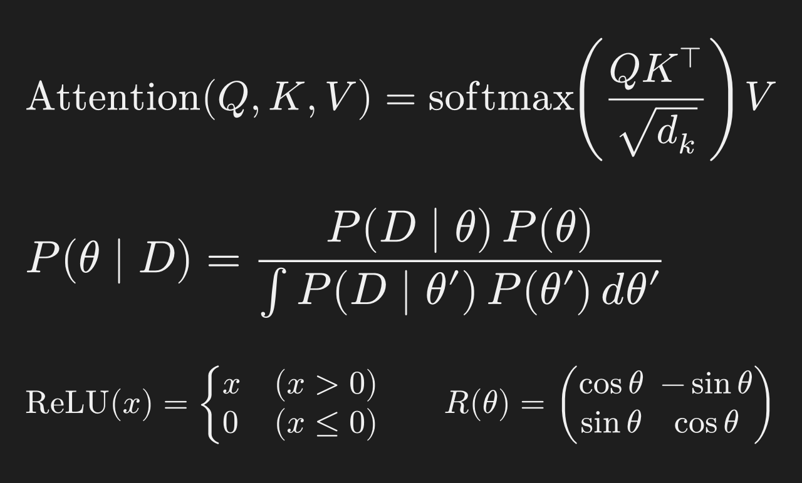
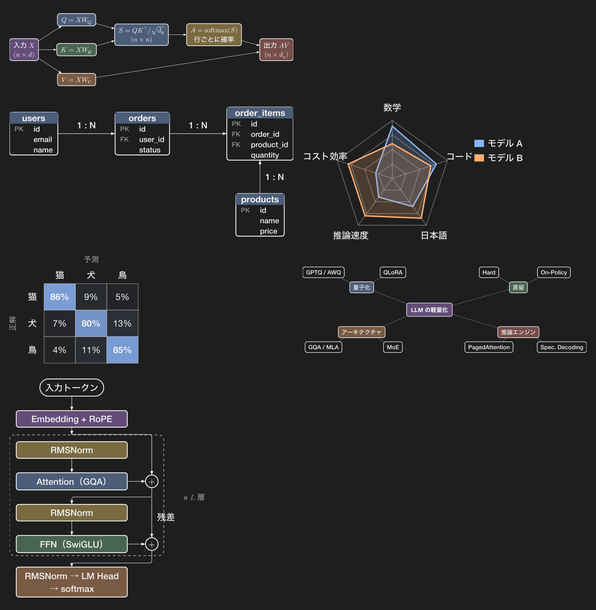

# figure-view

A [Claude Code](https://code.claude.com) mod that draws **only the display math and the figures** of Claude's answers as pictures in your terminal. Everything else — paragraphs, lists, tables, code — stays plain terminal text, so it scrolls, selects and searches as usual and the terminal holds few, small pictures.

| Part of an answer | Shown as |
|---|---|
| Display math (`$$ … $$`, `\[ … \]`) | a typeset picture of that formula |
| ` ```typst ` blocks (diagrams, ER diagrams, charts, plots) | a picture of that drawing |
| Inline math (`$x^2$`) | Unicode text (x², α, mₜ/(√vₜ+ε)) |
| Everything else | Claude Code's own Markdown text |

Pictures are typeset with [Typst](https://typst.app) and sized to whole terminal cells. A long answer only draws the pictures within a screen of the view; the others turn into one dim line of the same height and come back when you scroll to them. This keeps a terminal's image memory small (some terminals cap it per pane, for example [Orca](https://github.com/stablyai/orca) at 32 MB).

## What it looks like

Sample output, typeset by the mod's own template (dark theme):





## Requirements

- Claude Code 2.1.298 or later (mods)
- [Typst](https://typst.app) 0.15: `brew install typst`
- A terminal that shows Kitty Unicode-placeholder images: kitty, Ghostty, cmux, Orca 1.4.229+. In other terminals the pictures show as text.

## Install

In Claude Code:

```
/plugin install figure-view --marketplace Kenyan822/figure-view
```

## Commands

| Command | What it does |
|---|---|
| `/figure status` | Shows the state, size, Typst path and the cell size it found |
| `/figure on` / `off` | Turns the pictures on or off |
| `/figure size <50–800>` | Picture size in percent of the terminal text (default 300; figures are drawn at 60% of that) |
| `/figure dark` / `light` | Colours for a dark or a light terminal |
| `/figure redraw` | Sends every picture to the terminal again (when the terminal dropped them, as Orca does on a tab switch) |
| `/figure open` | Writes the last answer to `.figure-view/answer.md` and opens it (in Orca's Markdown preview, or the default app) |

## How it works

1. `prompt.compose` tells Claude that display math and ` ```typst ` blocks are drawn as pictures (and which Typst packages and `theme` colours it can use).
2. `ui.render` on `AssistantMessage` splits each answer into text, display math and Typst blocks. Only finished blocks are compiled, so a streaming block stays text.
3. Each piece is compiled once with `typst compile` into a PNG whose size is a whole number of cells, and drawn with the engine's `Image` element.
4. `onScreen` tells which rows of the answer are in view; pictures more than a screen away are replaced by text of the same height.

Typst runs with no network (packages are vendored under `render/packages/`) and with its root set to a work folder in `$TMPDIR`, so a Typst block reads nothing else.

## Limits

- Inline math is a Unicode approximation; write tall math as display math.
- Copying a picture with the mouse copies the image's placeholder characters; use Claude Code's `/copy` for the Markdown.
- Scrolling over pictures is not smooth: pictures are swapped in and out as the view moves.
- Orca keeps at most 32 MB of decoded pictures per pane ([stablyai/orca#23547](https://github.com/stablyai/orca/issues/23547)) and drops them on a tab switch ([#30383](https://github.com/stablyai/orca/issues/30383)). The mod keeps pictures small and only near the view; `/figure redraw` brings back dropped ones.

## See also

[mermaid-view](mermaid-view/README.md), in the same marketplace: Mermaid diagrams drawn as terminal text (`/plugin install mermaid-view --marketplace Kenyan822/figure-view`).

## Licence

MIT. The vendored Typst packages keep their own licences: see [THIRD-PARTY-NOTICES.md](THIRD-PARTY-NOTICES.md).

---

## 日本語

Claude Code の回答のうち、**別行の数式と図だけ**を画像にしてターミナルに表示する Mod です。文章・箇条書き・表・コードは普通の文字のままなので軽く、スクロールやコピーもいつもどおりです。図は ` ```typst ` ブロック（ER 図、構成図、グラフなど）で描かれます。

インストール：Typst を入れて（`brew install typst`）、Claude Code で `/plugin install figure-view --marketplace Kenyan822/figure-view`。使い方は上の Commands の表を見てください。
